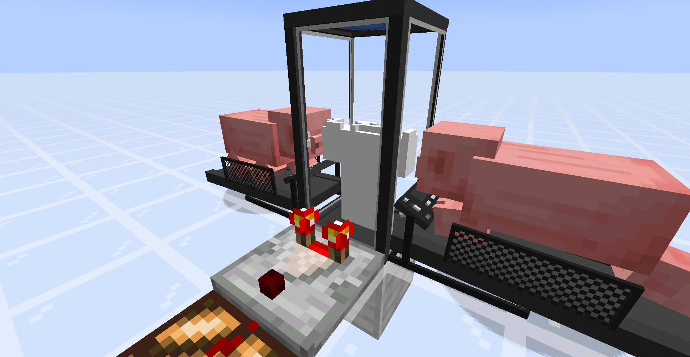
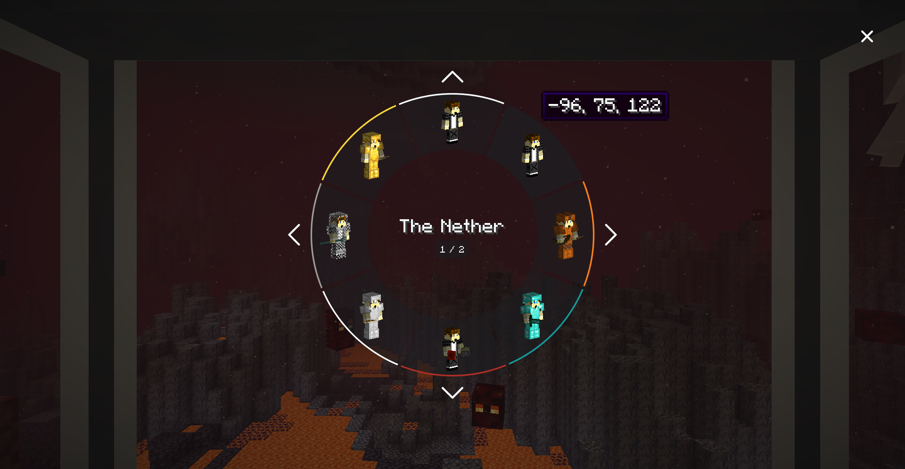

# Neosync Reimagined

> One mind. Many bodies.

Neosync Reimagined provides *shells*; clones of the player, each with their own inventory, experience, and gamemode, that you can transfer your consciousness into. This is a **NeoForge 1.21.1** port of the Fabric reimplementation by [Kir_Antipov](https://github.com/Kir-Antipov/sync-fabric), of the original [Sync](https://github.com/iChun/Sync) mod by [iChun](https://github.com/iChun).

----

## How to play

1. Craft a **shell constructor** and place it.
2. Right-click it with an empty hand to provide a genetic sample.
   > ⚠️ With default config this will **kill you** (20 HP, or 40 in hardcore). Eat a golden apple for extra health, hold a totem of undying, or enable `warnPlayerInsteadOfKilling` in the config.
3. Power the constructor: place a **treadmill** touching any side of it, lure a **pig** or **wolf** onto the front block, and piggawatts flow. (Any Forge Energy source works too.)

   

   > A comparator on the constructor tracks build progress.

4. Once the shell is built, craft a **shell storage**, place it, and supply redstone power (or FE from any tech mod).
5. When the storage doors open, walk in. A radial menu appears with your shells:

   

6. Pick a shell. Sync.

## Notes

- Sneak and right-click a shell constructor or shell storage with **dye** (or right-click a storage directly with dye) to color its trim and color-code the shell in the radial menu.
- Syncing works cross-dimensionally (including custom dimensions).
- If you die in a shell, you auto-sync to your next available shell based on `syncPriority` (defaulting to natural bodies first). Shell deaths **don't** count towards your death counter.
- Hoppers connected to a shell container can insert or extract items and equip armor/offhand gear on the stored shell.
- Shell storage needs continuous power to keep its shell alive (configurable); accepts redstone and/or FE.
- Shell constructors can optionally require fluid (such as water) alongside FE if `enableFluidConsumption` is enabled in the config.
- Comparator output from a shell container reports either *build progress* or *inventory fullness*. Right-click the container with a **wrench** (stick by default) to toggle.
- Shell containers are fragile - mine them with **silk touch** to pick them up.

## Commands

All commands live under `/neosync` (requires OP level 2 on servers):

- `/neosync select [target]` - Opens the radial shell selector UI from anywhere without needing to step into a storage unit.
- `/neosync anchor set <target> <dimension> <pos> [temporary]` - Creates a virtual respawn anchor that appears in the target's shell menu (`ensure` only sets one if the player has no shells in that dimension; `remove` and `list` manage existing anchors).
- `/neosync ghostshells <sync|remove|repair> <target> [pos]` - Cleans up or repairs desynced shells in a player's radial menu.
- `/neosync purge <target> [dimension]` - Destroys and removes all shells belonging to a player (optionally restricted to one dimension).

## Config

Config file: `config/neosync-common.toml`

| Key | Default | Effect |
| --- | --- | --- |
| `enableInstantShellConstruction` | `false` | Instant shell builds in creative mode |
| `warnPlayerInsteadOfKilling` | `false` | Prevent fingerstick damage from killing low-HP players |
| `fingerstickDamage` / `hardcoreFingerstickDamage` | `20.0` / `40.0` | HP consumed when sampling a shell |
| `shellConstructorCapacity` | `256000` | Base FE capacity for a shell constructor |
| `shellConstructionSpeed` | `2.5` | Build speed multiplier (`shellConstructorCapacity / shellConstructionSpeed` FE per shell) |
| `shellStorageCapacity` / `shellStorageConsumption` | `320` / `16` | FE buffer and per-tick drain keeping a stored shell alive |
| `enableFluidConsumption` | `false` | Require fluid input in the shell constructor to build shells |
| `shellConstructorFluidAmount` / `shellConstructorFluidCapacity` | `1000` / `10000` | mB consumed per shell and internal tank capacity |
| `shellConstructorFluidTypes` | `["minecraft:water"]` | Fluid registry IDs accepted by the shell constructor |
| `acceptsRedstone` | `true` | Allow shell storage to run on redstone signal alone |
| `maxUnpoweredLifespan` | `20` | Ticks a shell storage keeps its shell alive after losing power |
| `energyMap` | chicken=2, pig=16, player=20, wolf=22, villager=25, creeper=80, enderman=160 | FE/tick generated per entity on a treadmill |
| `syncPriority` | `["NATURAL"]` | Priority order when auto-syncing on death (`NATURAL`, `NEAREST`, or any dye color) |
| `autoSyncOnDeath` | `true` | Automatically sync into another finished shell when dying in an artificial body |
| `wrench` | `minecraft:stick` | Item that toggles a container's comparator mode |

## Mod integration

- **[JEI](https://www.curseforge.com/minecraft/mc-mods/jei)** - Item info pages for each block and a *Treadmill Energy Sources* category showing valid entities and their FE/tick output.
- **[Jade](https://www.curseforge.com/minecraft/mc-mods/jade)** - Tooltip support for the shell constructor, shell storage, and treadmill (owner, build progress, color, power state, and stored energy).
- **[CC: Tweaked](https://www.curseforge.com/minecraft/mc-mods/cc-tweaked)** - Adds two peripheral blocks for computer-controlled shell production:
  - **Sampler** (`sampler`): Right-clicking its front face with empty hands records your UUID (`getSampledUUID()`) and queues a `player_sampled` computer event.
  - **Interactor** (`interactor`): Place facing a shell constructor and call `interact(uuid)` to start building a shell for that player remotely without dealing fingerstick damage. Ships with a built-in `neosync/automate` ROM script.
- **[Curios](https://www.curseforge.com/minecraft/mc-mods/curios)** - Equipped curios are stored per shell and rendered on shells inside containers.
- **[Mekanism](https://www.curseforge.com/minecraft/mc-mods/mekanism)** - Radiation levels are tied to each individual shell rather than following you across bodies.
- **[Dragon Survival](https://www.curseforge.com/minecraft/mc-mods/dragons-survival)** - Preserves dragon form/data per shell and renders dragon bodies in containers and the radial menu.
- **Sable / Create Aeronautics** - Shell containers and treadmills function properly on contraptions and sub-levels.

All integrations are optional.

## Installation

Requirements:
- Minecraft `1.21.1`
- NeoForge `21.1.x`
- [GeckoLib](https://www.curseforge.com/minecraft/mc-mods/geckolib) `4.7+`

Grab the jar from a local `./gradlew build` (`build/libs/Neosync-Reimagined-*.jar`) or from Releases.

## License

MIT. Code by [Kir_Antipov](https://github.com/Kir-Antipov); NeoForge 1.21.1 port by BreakinBlocks. Original concept by [iChun](https://github.com/iChun). See [LICENSE](LICENSE) for details.
